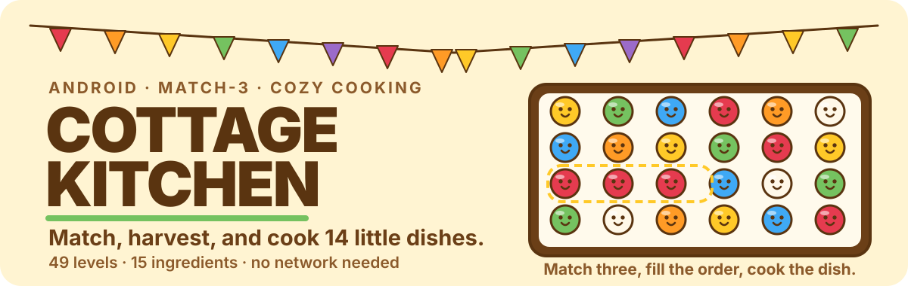
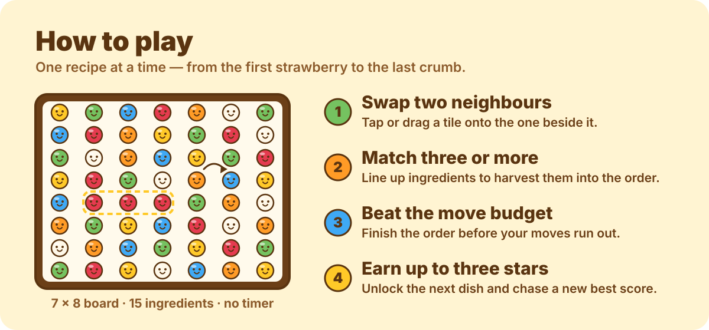

<p align="center">
  
</p>

# Cottage Kitchen

A cosy cooking match-3 game for Android. Swap ingredients, harvest what a recipe asks for, and fill the order before you run out of moves. Fourteen dishes, 49 levels, and a recipe book that fills in as you cook.

No account, no ads, no network access — just a board, a wooden spoon, and a very hungry cottage.

## The dishes

<p align="center">
  
</p>

Every dish is cooked one ingredient at a time. Progress shows up right on its recipe card: grey dishes come to life, filling with colour from the bottom as each ingredient lands in the pan.

## How to play

<p align="center">
  
</p>

- Swap adjacent tiles on the 7 × 8 board — tap two neighbours or drag one onto the other. Invalid swaps bounce back.
- Match three or more in a row to collect that ingredient for the current order. Cascades build combos and multiply the score.
- Match five in a row or make an L/T shape for a batch-cooking bonus: one extra move, once per level.
- Collect everything on the order before the moves run out. There is no timer: only the move budget puts on the pressure.
- Finish with moves to spare for one to three stars. Stars unlock the next level and, along with your best score, are saved on the device.
- From level 20, some orders include crates. They cannot be swapped; clear tiles beside them twice to break them.
- Idle for six seconds and a hint appears. A board with no legal moves reshuffles itself.

The whole game is one Android `View` drawing with `Canvas`: no game engine, no XML layouts, no AndroidX, and no third-party libraries. Art and sound effects are bundled locally, and progress lives in `SharedPreferences`.

## Install

Cottage Kitchen needs **Android 7.0 (API 24) or newer**. It runs offline and in portrait orientation.

### From an APK

Signed APKs are uploaded as artifacts by the [release workflow](.github/workflows/android-release.yml) when a `v*` tag is pushed or the workflow is run manually. Download `cottage_kitchen.apk` to your phone, tap it, and allow "Install unknown apps" when prompted.

### Build from source

You need JDK 17 or newer (CI uses 21) and the Android SDK with API 36 installed.

```bash
git clone https://github.com/russelldickenson/cottage-kitchen.git
cd cottage-kitchen
export ANDROID_HOME="$HOME/Library/Android/sdk"   # point this at your SDK
./gradlew assembleDebug
adb install -r app/build/outputs/apk/debug/cottage_kitchen.apk
```

On Windows, use `gradlew.bat` instead of `./gradlew`. You can also open the project in Android Studio and run the `app` configuration.

### Signed release build

[`build.sh`](build.sh) builds the release APK, verifies its signature with `apksigner`, and copies it to the repository root. Signing credentials stay outside the repository:

```bash
export ANDROID_KEYSTORE_PATH="$HOME/.android-signing/android-shared.p12"
export ANDROID_KEYSTORE_PASSWORD="$( ... )"   # read it from your password manager
./build.sh
```

The key alias defaults to `cottagekitchen` in [`gradle.properties`](gradle.properties); override it with `ANDROID_KEY_ALIAS` if needed. The APK is written to `app/build/outputs/apk/release/cottage_kitchen.apk` and copied to `./cottage_kitchen.apk`. Running `./gradlew assembleRelease` with the same environment variables produces the same APK without the copy and verification steps.

## License

Cottage Kitchen is free software released under the [GNU General Public License v3.0](LICENSE).

## Authors

- **Russell Dickenson** — creator and maintainer ([@russelldickenson](https://github.com/russelldickenson))
