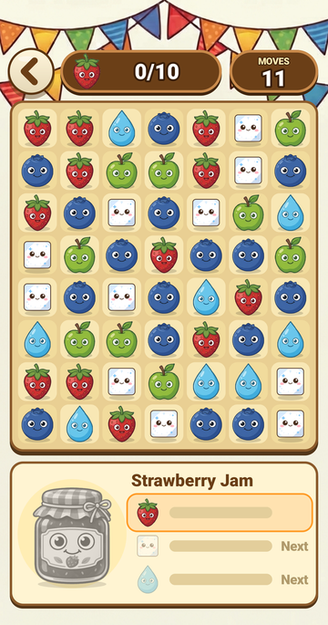
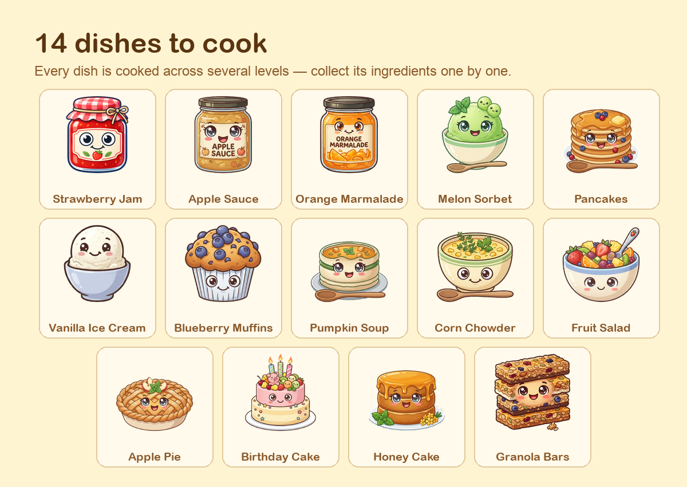

# Cottage Kitchen

A cosy cooking match-3 game for Android. Swap ingredients, harvest what a recipe asks for, and fill the order before you run out of moves. Fourteen dishes, 49 levels, and a recipe book that fills in as you cook.

No account, no ads, no network access — just a board, a wooden spoon, and a very hungry cottage.

  

<em>First order: harvest 10 strawberries in 11 moves.</em>

## The dishes

  

Every dish is cooked one ingredient at a time. Progress shows up right on its recipe card: grey dishes come to life, filling with colour from the bottom as each ingredient lands in the pan.

## How to play

  

- Swap adjacent tiles on the 7 × 8 board — tap two neighbours or drag one onto the other. Invalid swaps bounce back.
- Match three or more in a row to collect that ingredient for the current order. Cascades build combos and multiply the score.
- Match five in a row or make an L/T shape for a batch-cooking bonus: one extra move, once per level.
- Collect everything on the order before the moves run out. There is no timer: only the move budget puts on the pressure.
- Finish with moves to spare for one to three stars. Stars unlock the next level and, along with your best score, are saved on the device.
- From level 20, some orders include crates. They cannot be swapped; clear tiles beside them twice to break them.
- Idle for six seconds and a hint appears. A board with no legal moves reshuffles itself.

## License

Cottage Kitchen is free software released under the [GNU General Public License v3.0](LICENSE).

## Authors

- **Russell Dickenson** — creator and maintainer ([@russelldickenson](https://github.com/russelldickenson))

Build instructions and other details for contributors are in [CONTRIBUTING.md](CONTRIBUTING.md).
